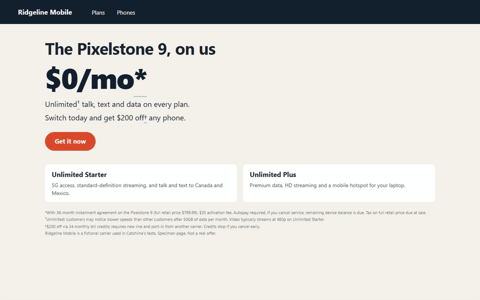
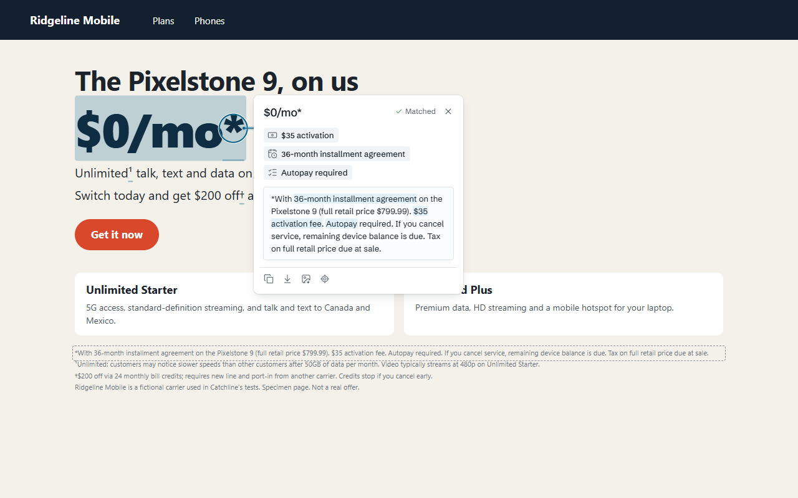
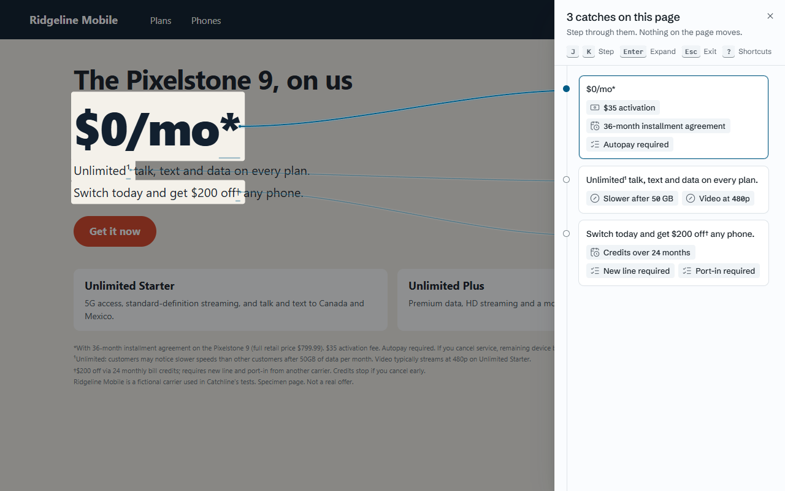
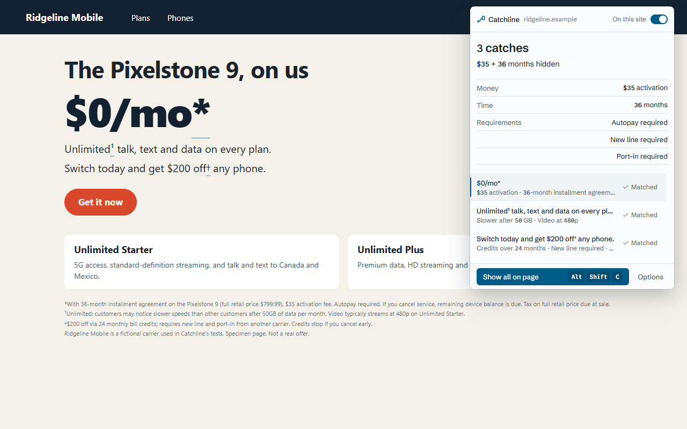

# Catchline

**A browser extension that pulls the fine print up next to the claim it qualifies.** Click the `*`
on "$0/mo\*" and the footnote from the bottom of the page flies up beside it, with the conditions
as chips: "$35 activation", "36-month installment agreement", "Autopay required".

[](LICENSE)
[](https://github.com/NINJA981/catchline/actions/workflows/ci.yml)



<sub>The page in every image is a fictional specimen ("Ridgeline Mobile"). Not a real offer.</sub>

No AI, no account, no backend, no analytics, and no network requests. Free and open source (MIT).

## What it does

- **Finds the markers:** `*`, `†`, `‡`, `§`, `¶`, superscript numbers (`<sup>3</sup>`, `¹`) and
  phrases such as "Terms apply" or "See offer details". It skips cents written as a superscript
  after a price, ordinals, trademarks, math, code, bullets and ratings.
- **Matches each one to its footnote,** even when the page does not link them and the text hides in
  a collapsed accordion. Linked footnotes (`href="#fn1"`, `aria-describedby`) come first, then a
  search of legal sections, small type and `<details>` for the same marker. Each match has a
  confidence; a marker with no footnote says "No footnote found" instead of guessing.
- **Picks the right sentence** when one `*` points at a 600-word offer block, and keeps the full
  text one click away.
- **Turns the conditions into chips:** money, time, rate, requirement, exclusion and renewal. The
  merchant's own words are always shown under the chips.
- **Show all** (`Alt+Shift+C`): the page dims, every claim gets a tether to a rail of cards, and
  `J`/`K` step through them.
- **Toolbar badge** with the count, and a popup ledger such as "3 catches: $35 + 36 months hidden".
- **Share this catch:** a 1200 x 630 PNG of the card, drawn locally.

| The card | Show all | The popup |
|---|---|---|
|  |  |  |

## Install

Catchline is **not yet listed** in the Chrome Web Store or on Firefox Add-ons. Until it is, load it
from a release zip or from source.

**Chrome, Edge, Brave (from a zip)**

1. Download `catchline-0.1.0-chrome.zip` from the [latest release](https://github.com/NINJA981/catchline/releases)
   (also in [`docs/launch/`](docs/launch)) and unzip it.
2. Open `chrome://extensions` and turn on **Developer mode**.
3. Click **Load unpacked** and pick the unzipped folder (the one with `manifest.json`).

**Firefox 140 or newer (temporary install)**

1. Download `catchline-0.1.0-firefox.zip` and unzip it.
2. Open `about:debugging#/runtime/this-firefox` and click **Load Temporary Add-on...**.
3. Pick `manifest.json` in the unzipped folder. Firefox treats site access as optional for MV3
   add-ons: grant it on the welcome page, or Catchline only runs after you click its toolbar button.
   Temporary add-ons are removed when Firefox restarts.

**From source:** `pnpm install && pnpm build` (Chrome, output in `.output/chrome-mv3`) or
`pnpm build:firefox` (`.output/firefox-mv3`), then load that folder as above.

On install, a welcome page opens with a specimen to try the gesture on.

## How it works

1. **Scan.** A small content script walks the page text in 8 ms slices, so it never blocks the page,
   and collects markers. Pages over 15,000 text nodes scan only `main`, footers and legal sections.
2. **Match.** Linked footnotes first; otherwise the same glyph at the start of a block in a legal
   container, small type or a closed accordion, scored by position and word overlap.
3. **Extract.** Ordered regular-expression rules per page type (carrier, bank, retail, streaming,
   SaaS, travel) turn the footnote sentence into chips. Deterministic: the same page gives the same
   chips.
4. **Show.** Clicking a marker injects the overlay (React in a Shadow DOM root, so the page's CSS
   cannot touch it and it cannot touch the page). The footnote's position is measured, a copy flies
   up a bezier tether and docks beside the claim. Reduced motion replaces the flight with a fade.

The engine (`src/core`) is plain TypeScript with no browser API, shared by the extension and the
web app in `site/`. To see what it finds on a saved page without a browser:

```
pnpm engine tests/fixtures/synthetic/carrier-specimen.html      # JSON: markers, footnotes, chips
```

## Privacy

- Page text is read in memory to find footnotes. **Nothing is sent anywhere:** the extension makes
  no network requests. `pnpm check:network` fails the build if a network primitive or external URL
  appears in it, and the e2e suite records every request while scanning pages.
- **Stored:** your settings in `chrome.storage.local`, and per-tab counts and chip labels in
  `chrome.storage.session`, which the browser clears when the tab or browser closes. No URLs, no
  page text, no history.
- The fonts ship inside the extension. They are added to a page through the `FontFace` API, so the
  extension's URL never appears in page-readable CSS.

### Permissions

| Permission | Why |
|---|---|
| `<all_urls>` (host access) | The scanner runs on every page so the badge can show a count without a click. With "Only when I click the toolbar button" in Options, the script still loads but scans nothing until you open Catchline on that page. |
| `activeTab` | Lets the overlay run on the current tab after a click or shortcut, including on Firefox when site access was not granted. |
| `scripting` | Injects the overlay into the tab only when you open a card or Show all. |
| `storage` | Settings, and the per-tab counts the popup shows. |

`web_accessible_resources` exposes only the three font files. The Firefox build declares
`data_collection_permissions: none`.

## Keyboard

| Key | Action |
|---|---|
| `Alt+Shift+C` | Show all catches on the page |
| `Esc` | Close a card, or leave Show all |
| `J` / `K` | Next / previous catch in Show all |
| `Enter` | Expand the selected catch |
| `C` / `S` / `I` | Copy the footnote / save the card as an image / copy the card as an image |
| `G` | Go to the footnote on the page |
| `?` | List the shortcuts in Show all |

Single keys only work while a card or Show all is open, never while you type in a page.

## Limitations

- **Match rate is not yet measured on a public corpus.** The 15 test pages in
  `tests/fixtures/synthetic` are hand-written for fictional companies; they prove the code paths,
  not accuracy on real sites. An earlier internal trial on saved third-party pages is not published:
  those pages cannot be redistributed, so the number could not be reproduced from this repository.
- **Firefox is built and linted, not runtime-tested.** Playwright cannot load Firefox add-ons, and
  the manual smoke checklist in [HANDOFF.md](HANDOFF.md) has not been run.
- Fine print inside images, canvas or video is out of reach (no OCR).
- Terms on a separate `/legal` page are shown as a "Terms are on another page" link, not fetched.
- Cross-origin iframes are not scanned.
- Mobile Chrome has no extensions. The [web app](site/README.md) runs on phones: paste a page's
  text or HTML and it shows the same cards.
- The optional on-device "plain-language line" in Options is a saved setting only; no model is
  called in this version.
- Bundle sizes are over their targets (scanner content script about 28 kB gzip against 22 kB);
  `pnpm check:size` stops them from growing.

## Development

Requirements: Node 22 or newer, pnpm 10.

```
pnpm install
pnpm build            # Chrome, .output/chrome-mv3 (load unpacked)
pnpm build:firefox    # .output/firefox-mv3
pnpm zip              # .output/catchline-<version>-chrome.zip
pnpm zip:firefox      # Firefox zip plus the sources zip AMO asks for
pnpm lint             # ESLint (strict, type-checked) + Prettier
pnpm typecheck
pnpm test             # Vitest unit and component tests
pnpm test:e2e         # builds, then Playwright against the built extension
pnpm check:network    # after a build: no network code in the bundle
pnpm check:size       # after a build: bundle-size ceilings
pnpm verify           # all of the above plus the site, in order
```

Playwright needs Chromium once: `pnpm exec playwright install chromium`. `pnpm dev` starts WXT with
hot reload.

```
src/core/         the engine: pure TypeScript, DOM in and data out, no browser APIs
src/overlay/      the in-page card, tether, flight, Show all and share image (Shadow DOM)
src/entrypoints/  background, scanner and overlay content scripts, popup, options, welcome
src/adapters/     src/storage/  src/messaging/  src/dom/   thin wrappers around browser APIs
src/ui/           design tokens and shared components
site/             landing page and the offline web app (/app), same engine
tests/            unit (Vitest), e2e (Playwright), synthetic fixtures
docs/             architecture decision record, testing matrix, launch assets
```

Design and behaviour are specified in [SPEC.md](SPEC.md), [DESIGN.md](DESIGN.md) and
[docs/adr/0001-architecture.md](docs/adr/0001-architecture.md); [docs/TESTING.md](docs/TESTING.md)
maps every acceptance criterion to its tests.

## Contributing

Bug reports with a saved page (or a fictional page that reproduces the pattern) are the most useful
thing you can send. See [CONTRIBUTING.md](CONTRIBUTING.md), the
[code of conduct](CODE_OF_CONDUCT.md) and the [security policy](SECURITY.md).

## License

[MIT](LICENSE). Fonts: Schibsted Grotesk and Commit Mono (SIL Open Font License 1.1), bundled from
Fontsource.
